<div align="center">

  # ⚡ Nilesh | DevOps & Cloud Infrastructure Hub

  <a href="https://github.com/Nilesh-Devopss">
    
  </a>

  <p align="center">
    <strong>Building resilient, automated, and scalable cloud systems.</strong><br>
    <em>A central launchpad for my projects, architectures, and an interactive Contact Me landing page.</em>
  </p>

  <p align="center">
    <a href="#-about-me"></a>
    <a href="#-tech-stack--tools"></a>
    <a href="#-devops-lifecycle--architecture"></a>
    <a href="#-the-contact-me-app-inside-this-repo"></a>
    <a href="#-connect-with-me"></a>
  </p>

  <p align="center">
    <a href="https://github.com/Nilesh-Devopss"></a>
    
    
    
  </p>

</div>

---

## 🧭 Table of Contents
1. [🌟 About Me](#-about-me)
2. [🛠️ Tech Stack & Tools](#-tech-stack--tools)
3. [🔄 DevOps Lifecycle & Architecture](#-devops-lifecycle--architecture)
4. [💻 The "Contact Me" Web App (Inside This Repo)](#-the-contact-me-app-inside-this-repo)
5. [🚀 Quick Start & How to Run](#-quick-start--how-to-run)
6. [🌐 Deploy to GitHub Pages in 2 Minutes](#-deploy-to-github-pages-in-2-minutes)
7. [📊 GitHub Analytics](#-github-analytics)
8. [📬 Connect With Me](#-connect-with-me)

---

## 🌟 About Me

```bash
nilesh@cloud-terminal:~$ neofetch --devops
```

```ini
OS         : Linux (Ubuntu / Alpine / Debian)
Role       : DevOps & Cloud Infrastructure Engineer
Location   : India (UTC +5:30)
Specialty  : Infrastructure as Code (IaC), CI/CD Automation & Containers
Cloud      : Azure, AWS
Philosophy : "If you have to do it more than twice, automate it."
```

Hello! I am **Nilesh**, a DevOps engineer passionate about turning manual deployments into seamless, self-healing automated pipelines. I design clean infrastructure, containerize distributed services, provision cloud resources through code, and set up observable systems with proactive alerts.

- 🔭 Currently architecting **Azure Landing Zones** & Infrastructure as Code modules with **Terraform**.
- 🌱 Honing advanced **Kubernetes** orchestration, GitOps workflows, and multi-stage container pipelines.
- 💬 Ask me about **CI/CD pipelines, Dockerization, Terraform state management, DNS architecture, and Linux administration**.
- ⚡ Fun fact: My default response to server outages is checking logs before coffee!

---

## 🛠️ Tech Stack & Tools

<table>
  <thead>
    <tr>
      <th width="30%">Domain</th>
      <th width="70%">Technologies & Tools</th>
    </tr>
  </thead>
  <tbody>
    <tr>
      <td><strong>☁️ Cloud & Virtualization</strong></td>
      <td>
        
        
        
        
      </td>
    </tr>
    <tr>
      <td><strong>⚙️ CI/CD & Version Control</strong></td>
      <td>
        
        
        
        
      </td>
    </tr>
    <tr>
      <td><strong>📜 Infrastructure as Code</strong></td>
      <td>
        
        
      </td>
    </tr>
    <tr>
      <td><strong>📈 Monitoring & Logs</strong></td>
      <td>
        
        
      </td>
    </tr>
    <tr>
      <td><strong>💻 Scripting & OS</strong></td>
      <td>
        
        
        
        
      </td>
    </tr>
    <tr>
      <td><strong>🌐 Web & Front-End</strong></td>
      <td>
        
        
        
      </td>
    </tr>
  </tbody>
</table>

---

## 🔄 DevOps Lifecycle & Architecture

Here is the standard workflow I implement for deploying modern, reliable microservices and infrastructure:

```mermaid
flowchart LR
    subgraph Plan_and_Code ["1. Developer Space"]
        A["💻 Code & Test"] --> B["🔀 Git Branch & PR"]
    end

    subgraph CI_Pipeline ["2. Automated CI"]
        B --> C["🧪 Automated Lint & Tests"]
        C --> D["🐳 Container Build & Scan"]
        D --> E["📦 Push to Image Registry"]
    end

    subgraph CD_and_IaC ["3. Infrastructure & CD"]
        E --> F["📜 Terraform Plan & Apply"]
        F --> G["☸️ Kubernetes Deploy (Rolling Update)"]
    end

    subgraph Monitor_Stage ["4. Production Observability"]
        G --> H["📊 Prometheus & Grafana Metrics"]
        H --> I["🚨 Alertmanager (Slack/Email)"]
        I -.->|Feedback Loop| A
    end

    style Plan_and_Code fill:#1e293b,stroke:#38bdf8,stroke-width:2px,color:#f8fafc
    style CI_Pipeline fill:#1e293b,stroke:#6366f1,stroke-width:2px,color:#f8fafc
    style CD_and_IaC fill:#1e293b,stroke:#10b981,stroke-width:2px,color:#f8fafc
    style Monitor_Stage fill:#1e293b,stroke:#f59e0b,stroke-width:2px,color:#f8fafc
```



---

## 💻 The "Contact Me" Web App (Inside This Repo)

This repository includes a complete, production-ready static **Portfolio & Contact Me Landing Page** built with pure HTML, CSS, and Vanilla JavaScript.

### 🌟 Highlights
- 🌓 **Instant Dark / Light Mode Switch**: Clean contrast and smooth transitions with persistent state.
- 🖥️ **Live Terminal Emulator Card**: Displays real-time status and developer metadata.
- 📝 **Interactive Form with Validation**:
  - Live character counter (0 to 1000).
  - Regex email validation and inline feedback.
  - Loading animation state on submit.
  - Interactive toast notifications (success & error popups).
  - Built-in honeypot spam protection.
- 📋 **One-Click Email Copy**: Quickly copy email to clipboard with instant confirmation.
- 📱 **100% Mobile Responsive**: Seamless layout on phones, tablets, and desktop displays.
- ⚡ **Zero External Heavy Dependencies**: All SVG icons and styles are bundled locally for high-speed offline reliability.

### 🗂️ File Architecture
```
contactme/
├── index.html        # Semantic HTML5 layout, embedded SVGs & accessibility tags
├── styles.css        # CSS variables, dark/light themes, animations & responsive grid
├── script.js         # Theme management, form validation, clipboard utility & toasts
└── README.md         # This repository overview and getting started guide
```

---

## 🚀 Quick Start & How to Run

Clone this repository to your local workstation:

```bash
# Clone the repository
git clone https://github.com/Nilesh-Devopss/contactme.git

# Move into the project directory
cd contactme
```

### Run Locally (Choose Any):

<details>
<summary><strong>Option A: Direct in Browser (Simplest)</strong></summary>

Double-click `index.html` or open it directly in Google Chrome, Edge, or Firefox.
</details>

<details>
<summary><strong>Option B: Python Built-in Server</strong></summary>

```bash
python -m http.server 8000
```
Open [http://localhost:8000](http://localhost:8000) in your browser.
</details>

<details>
<summary><strong>Option C: Node.js / npx serve</strong></summary>

```bash
npx serve .
```
</details>

<details>
<summary><strong>Option D: VS Code Live Server</strong></summary>

Right-click `index.html` in VS Code and select **"Open with Live Server"**.
</details>

---

## 🌐 Deploy to GitHub Pages in 2 Minutes

You can host this entire landing page live on the web for free using GitHub Pages:

1. Push your changes to the `main` branch:
   ```bash
   git add .
   git commit -m "feat: launch devops hub & contact page"
   git push origin main
   ```
2. In your GitHub repository:
   - Click **Settings** (top right tab).
   - Click **Pages** in the left sidebar menu.
   - Under **Build and deployment** > **Source**, choose **Deploy from a branch**.
   - Under **Branch**, select `main` and directory `/(root)`.
   - Click **Save**.
3. Your website will be live at:
   ```
   https://nilesh-devopss.github.io/contactme/
   ```

---

## 📬 Connecting the Contact Form to Your Email

Want submissions from the form sent straight to your email inbox without running a server?

### Option 1: Using [Web3Forms](https://web3forms.com/) (Free, No Password needed)
1. Get an access key from [web3forms.com](https://web3forms.com/) (takes 30 seconds).
2. In `index.html`, add your key inside `<form id="contactForm">`:
   ```html
   <input type="hidden" name="access_key" value="YOUR_WEB3FORMS_ACCESS_KEY" />
   ```
3. Set form action to:
   ```html
   <form id="contactForm" action="https://api.web3forms.com/submit" method="POST">
   ```

### Option 2: Using [Formspree](https://formspree.io/)
1. Create a free form at [formspree.io](https://formspree.io/).
2. Set form action attribute in `index.html`:
   ```html
   <form id="contactForm" action="https://formspree.io/f/YOUR_FORM_ID" method="POST">
   ```

---

## 📊 GitHub Analytics

<div align="center">
  
  
</div>

<div align="center">
  
</div>

---

## 📬 Connect With Me

I'm always excited to collaborate on DevOps pipelines, cloud architectures, open-source projects, and new opportunities.

<div align="center">

  <a href="https://github.com/Nilesh-Devopss">
    
  </a>
  &nbsp;
  <a href="https://linkedin.com/in/">
    
  </a>
  &nbsp;
  <a href="mailto:nilesh.devops@example.com">
    
  </a>

</div>

<br>

<div align="center">
  <sub>⭐ If you find this template or repository useful, feel free to star the repo and fork it for your own use!</sub><br>
  <sub>Crafted with passion by <strong>Nilesh</strong> &bull; © 2026</sub>
</div>
